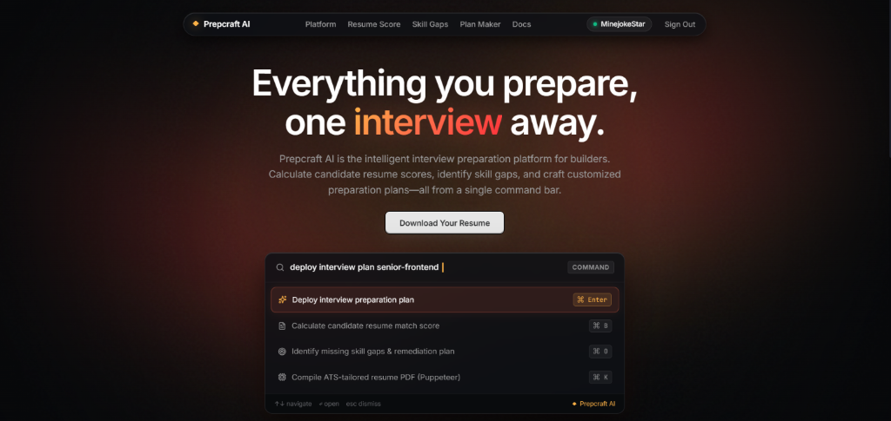
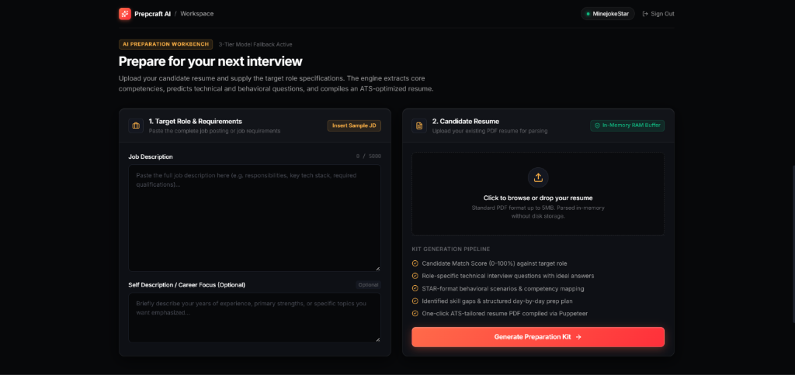
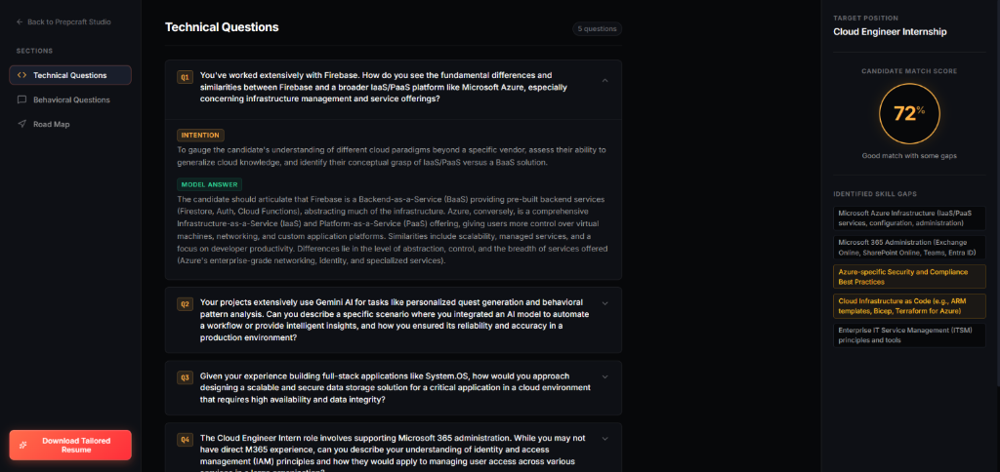
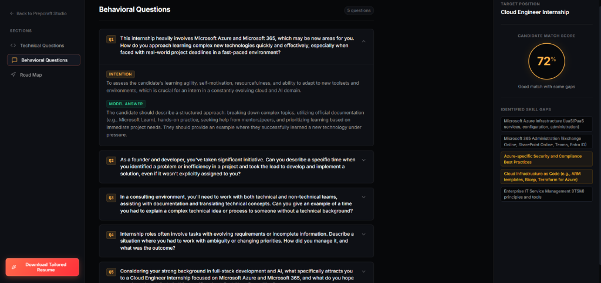
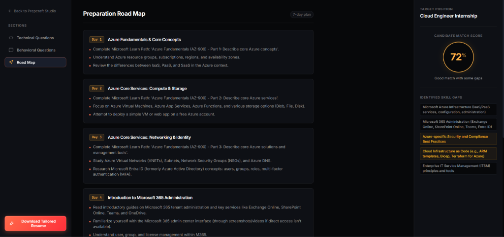

# Prepcraft AI 🚀

> The intelligent, developer-first interview preparation platform powered by Google Gemini AI.

[](https://react.dev/)
[](https://vitejs.dev/)
[](https://nodejs.org/)
[](https://expressjs.com/)
[](https://www.mongodb.com/)
[](https://aistudio.google.com/)
[](https://sass-lang.com/)

---

## 🌟 Overview

**Prepcraft AI** is a career intelligence platform designed for software engineers. It bridges the gap between candidate resumes and real-world job requirements using structured LLM intelligence and a modern developer-tool aesthetic.

Behind its signature **Living Animated Aurora** canvas, Prepcraft AI ingests target job postings and candidate PDF resumes to compute match scores, pinpoint critical skill gaps, generate tailored technical and behavioral interview drills with interviewer intentions and model answers, and compile ATS-optimized resumes on the fly.

---

## 📸 Product Preview & Walkthrough

### 1. Living Animated Aurora Hero
A dark `#07080a` developer-tool landing viewport with pure-CSS drifting aurora light-blades (crimson, coral, amber), floating pill navigation, and tactile keycap action.



---

### 2. AI Preparation Workbench
A 2-column studio to supply target role specifications and drop in-memory PDF candidate resumes with 1-click sample JD insertion.



---

### 3. Role-Specific Technical Questions & Match Score
Interactive accordions displaying predicted technical interview questions with the interviewer's **Intention** and detailed **Model Answers**, accompanied by the candidate match score gauge ring and categorized skill gaps.



---

### 4. STAR Behavioral Scenarios & Competency Drills
Behavioral interview questions tailored to the position, providing insights into why each question is asked and how to answer effectively.



---

### 5. Structured Day-by-Day Preparation Road Map
Step-by-step preparation plan broken down into actionable daily milestones, learning paths, and technical focus areas.



---

## ✨ Key Features

### 🎯 1. End-to-End Interview Preparation Pipeline
- **Job Description & Resume Ingestion:** Accepts complex job requirements and extracts competencies directly from candidate PDF resumes.
- **Candidate Match Scoring (0–100%):** Calculates an objective compatibility score indicating role readiness.
- **Skill Gap Identification:** Pinpoints missing qualifications and categorizes them with remediation strategies.
- **Structured Preparation Roadmap:** Creates a realistic day-by-day prep plan with targeted focus topics and practical exercises.
- **Role-Specific Technical Questions:** Generates deep technical questions tailored to the role, complete with the **Intention** behind the question and comprehensive **Model Answers**.
- **STAR Behavioral Scenarios:** Constructs situational and behavioral questions paired with the interviewer's evaluation criteria and ideal answers.
- **One-Click ATS Resume Generation & Download:** Compiles an ATS-tailored resume PDF via headless browser automation (`puppeteer`) ready for immediate download.

### ⚡ 2. Multi-Tier Gemini AI Fallback Architecture
- Resilient 3-tier LLM fallback pipeline (`gemini-2.5-flash`, `gemini-1.5-flash`, etc.) with strict JSON schema adherence and automatic failover, guaranteeing continuous availability without request drops.

### 🔒 3. Secure Cookie-Based Authentication
- JWT authentication stored securely in browser-level HTTP-only cookies to eliminate client-side XSS tampering.
- Password hashing with `bcrypt` and server-side token blacklisting in MongoDB for instantaneous, secure signout.

### 🌌 4. Living Animated Aurora Canvas
- Pure-CSS `@keyframes` drifting light-blades glowing in warm crimson (`#ff2f3a`), coral (`#ff6b4a`), and amber (`#ffb347`) layered under SVG `feTurbulence` film-grain and radial vignette (strictly warm palette, zero purple/indigo).

### 🛡️ 5. In-Memory RAM Buffer Processing
- Candidate PDF resumes are parsed in volatile RAM memory buffers using `pdf-parse` and `multer`, ensuring sensitive candidate resumes are never stored as unneeded files on disk.

---

## 🛠️ Tech Stack

### Frontend
- **Framework:** React 19 + Vite
- **Styling:** Custom Vanilla SCSS (Design tokens, glassmorphism, responsive grid, strictly warm palette)
- **Icons:** Lucide React
- **Animations:** Motion (`motion/react`) physics springs and transitions
- **Routing:** React Router v7

### Backend
- **Runtime:** Node.js (ES Modules)
- **Framework:** Express.js
- **Database:** MongoDB Atlas + Mongoose
- **AI Engine:** Google Gemini API (`@google/genai`)
- **PDF Extraction:** `pdf-parse` + `multer` (in-memory storage)
- **PDF Compilation:** `puppeteer` (headless browser PDF rendering)
- **Security:** `jsonwebtoken`, `bcrypt`, `cookie-parser`, `cors`

---

## 📁 Repository Structure

```text
prepcraft-ai/
├── .gitignore                   # Root git exclusions (blocks all .env files)
├── README.md                    # Project documentation & screenshots
├── assets/                      # Application walkthrough screenshots
│   ├── 01-landing-hero.png
│   ├── 02-preparation-workbench.png
│   ├── 03-technical-questions.png
│   ├── 04-behavioral-questions.png
│   └── 05-preparation-roadmap.png
│
├── Backend/                     # Express REST API & AI Pipelines
│   ├── .env.example             # Template for required environment variables
│   ├── .gitignore               # Backend-specific exclusions
│   ├── package.json
│   ├── server.js                # App entrypoint & database connection
│   └── src/
│       ├── app.js               # Express middleware & route mounting
│       ├── config/              # MongoDB connection configuration
│       ├── controllers/         # Auth & Interview request handlers
│       ├── middlewares/         # JWT auth guard & multer in-memory upload
│       ├── models/              # Mongoose schemas (User, InterviewReport, Blacklist)
│       ├── routes/              # Express API route declarations
│       └── services/            # Gemini AI integration & Puppeteer PDF compiler
│
└── Frontend/                    # React 19 + Vite Client
    ├── .gitignore               # Frontend exclusions
    ├── index.html               # Single page application root
    ├── package.json
    ├── vite.config.js
    └── src/
        ├── App.jsx              # Root component & state providers
        ├── app.routes.jsx       # Route definitions & protected route wrappers
        ├── main.jsx             # React DOM mounting
        ├── style.scss           # Global design tokens & CSS variables
        └── features/
            ├── auth/            # Auth state, login/register forms & API services
            └── interview/       # Living aurora hero, workbench & interview dashboard
```

---

## 🚀 Getting Started

### Prerequisites

- [Node.js](https://nodejs.org/) (v18.0.0 or higher recommended)
- [npm](https://www.npmjs.com/) or [pnpm](https://pnpm.io/)
- A free [MongoDB Atlas](https://www.mongodb.com/atlas) cluster
- A free [Google Gemini API Key](https://aistudio.google.com/)

---

### 1. Clone the Repository

```bash
git clone https://github.com/HonestShiven/prepcraft-ai.git
cd prepcraft-ai
```

---

### 2. Configure Backend

1. Navigate to the `Backend` directory:
   ```bash
   cd Backend
   ```

2. Install dependencies:
   ```bash
   npm install
   ```

3. Create your `.env` file from the provided `.env.example`:
   ```bash
   cp .env.example .env
   ```

4. Open `.env` and fill in your credentials:
   ```env
   MONGO_URI=mongodb+srv://<username>:<password>@<cluster>.mongodb.net/prepcraft?retryWrites=true&w=majority
   JWT_SECRET=your_jwt_secret_key_here
   GOOGLE_GENAI_API_KEY=your_gemini_api_key_here
   PORT=3000
   ```

5. Start the backend server:
   ```bash
   npm start
   # Server will run on http://localhost:3000
   ```

---

### 3. Configure Frontend

1. In a new terminal window, navigate to the `Frontend` directory:
   ```bash
   cd Frontend
   ```

2. Install dependencies:
   ```bash
   npm install
   ```

3. Start the Vite development server:
   ```bash
   npm run dev
   # App will be accessible at http://localhost:5173
   ```

---

## 🔒 Security Best Practices

- **Never Commit Secrets:** Real `.env` files are ignored by git in the root, Backend, and Frontend directories. Use `.env.example` as a template.
- **HTTP-Only Cookies:** Authentication tokens are stored inside browser-level HTTP-only cookies to prevent client-side XSS tampering.
- **In-Memory Uploads:** Resumes are processed in RAM memory buffers via Multer and are never persisted to the host filesystem.

---

## 📄 License

This project is licensed under the [MIT License](LICENSE).
